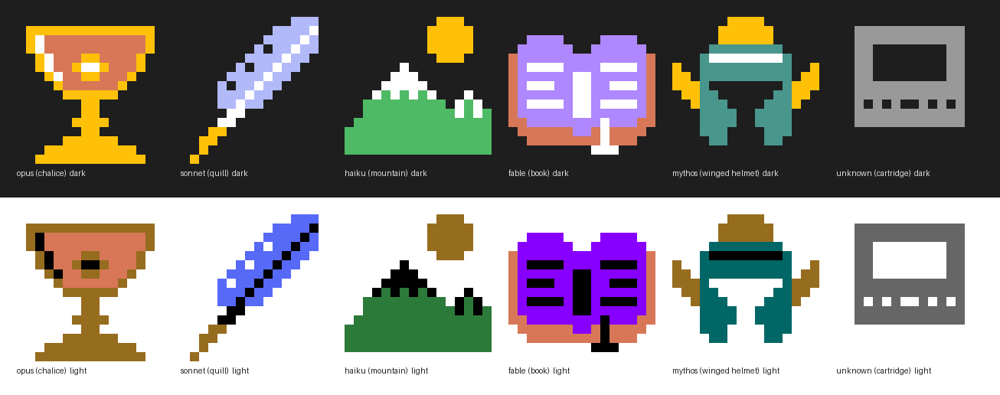

# model-meter

[](https://github.com/at0mikd/model-meter/actions/workflows/ci.yml)
[](https://github.com/at0mikd/model-meter/actions/workflows/codeql.yml)
[](https://scorecard.dev/viewer/?uri=github.com/at0mikd/model-meter)
[](LICENSE)

**A [Claude Code](https://code.claude.com) mod that shows, in 8-bit style, which model and effort level your session is using.** It is always visible in the terminal footer, and can also show a sprite band above the prompt.

```text
⏵⏵ auto mode on ·                                  ◆ Opus 5.5 ▮▮▮▯▯ high
```



## Features

- **Footer badge:** the model and effort, updated live on every turn and on `/model` and `/effort`. It uses the model family's color (Opus, Sonnet, Haiku, Fable or Mythos).
- **8-bit "off" state:** anything not known yet shows as an empty cartridge slot, at the same width, so nothing jumps when it lights up.
- **Plays well with other footer mods** such as `sub-meter`. It measures what is actually drawn on the row, and when space runs short it steps down in size, without covering anything or wrapping the footer.
- **Optional 8-bit band:** an original 12×12 sprite per model family, with the label `model Opus 5.5` · `power ▮▮▮▯▯ high`. In `auto` mode it shows only while the terminal is wide.
- **Read-only:** it never changes the model or the effort. It does not touch files, processes, the network or environment variables.

## Requirements

- Claude Code **2.1.327** or later (mod API).
- A terminal. The mod draws nothing in the desktop app, VS Code or mobile, which already show the model.
- For the band, a terminal with 24-bit color. Most current ones have it (Ghostty, iTerm2, WezTerm, Windows Terminal…).

## Installation

In Claude Code:

```text
/plugin marketplace add at0mikd/model-meter
/plugin install model-meter@model-meter
```

The badge appears in the footer, bottom right. The effort lights up after the first turn.

## Configuration

By default only the footer badge shows. To enable the band, set the options in `/config` (or under `pluginConfigs` in `settings.json`):

| Option | Values | Default | Effect |
| --- | --- | --- | --- |
| `placement` | `footer` · `auto` · `band` | `footer` | `auto`: adds the band while the terminal is wide. `band`: adds it whenever it fits. |
| `autoMinColumns` | 80–400 | `140` | With `auto`, the band shows from this width on and goes once the terminal is 20 columns narrower. |

You can fold the band at any time with **ctrl+x ctrl+a** or `[-]`. See the [mod's README](plugins/model-meter/README.md) for the details.

## Privacy and security

- **Data:** the mod stores only the **last effort level** (`low` … `max`), to show it dimmed in the next session. No prompts, paths or identifiers.
- **Capabilities:** a closed allowlist of engine calls, checked on every PR (`npm run capabilities`). Any new capability fails CI.
- **Supply chain:**
  - no runtime dependencies;
  - GitHub Actions pinned by SHA, with CodeQL, dependency review, gitleaks, actionlint, zizmor, OpenSSF Scorecard and a weekly audit;
  - `main` guarded by a ruleset: pull request required, 12 required checks, linear history and signed commits.
- **Vulnerabilities:** please do not open a public issue. Use [private reporting](SECURITY.md).

## How it is built

The project follows a **Reviewer–Builder** workflow:

- one agent designs, specifies and reviews;
- another implements with TDD and attaches evidence;
- a person, the Maintainer, approves every change.

Nothing reaches `main` without all checks green and that explicit approval.

| Document | Contents |
| --- | --- |
| [`docs/README.md`](docs/README.md) | Map of the documentation |
| [`docs/PLAN.md`](docs/PLAN.md) | Design, architecture, threat model and phases |
| [`docs/WORKFLOW.md`](docs/WORKFLOW.md) | Roles, task cycle, review and merge rules |
| [`docs/tasks/`](docs/tasks/) | Tasks with their acceptance criteria |
| [`CONTRIBUTING.md`](CONTRIBUTING.md) | Setup, quality gates and conventions |
| [`CHANGELOG.md`](CHANGELOG.md) | Changes per release |

## Repository layout

```text
plugins/model-meter/   the mod: hooks (register.tsx) and pure core (hooks/core/)
test/                  core tests (node --test, 100% coverage)
scripts/               project gates: audit, capabilities, commitlint
security/              approved audit exceptions (with expiry dates)
spikes/                throwaway research code (never published)
tools/claude-cli/      the Claude Code CLI pinned for CI
docs/                  plan, workflow, tasks, spike results and repository settings
```

## License

[MIT](LICENSE). The sprites are original designs made for this project.
