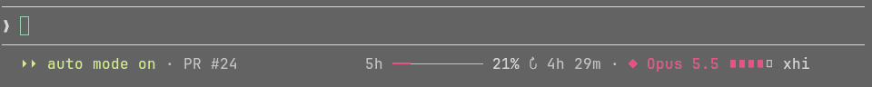

# model-meter

A Claude Code mod that shows, in the terminal's footer and in 8-bit style, which model and which effort level the session is using:

```text
◆ Opus 5.5 ▮▮▮▯▯ high · ⏵⏵ auto mode on
```



## What it shows

- **The model:** `◆` and the short name (`Opus 5.5`, `Sonnet 5.5 1m`, `Mythos 5.1`…) in its family's color, from the theme's tokens (never raw ANSI). A model it does not recognise shows as `?`, dimmed.
- **The effort:** a meter of 5 "pixels" (`low` = 1 … `max` = 5) and its label (`low`, `med`, `high`, `xhi`, `max`). A numeric effort (internal builds only) shows as `custom`, without a meter.
- **Lowercase,** like the rest of the footer (the mode label, the hints and other mods), except the model's name, which starts with a capital as Claude Code writes it (`Opus`, `Sonnet`).
- **Live:** it updates on every turn, at once after `/model`, and as **pending** (`high…`, dimmed) after `/effort`, until the next turn confirms it.
- **What is missing looks "switched off",** like an empty cartridge slot, without changing width:

  | Situation | Look |
  | --- | --- |
  | Everything known | `◆ Opus 5.5 ▮▮▮▯▯ high` |
  | Effort from a previous session | `◆ Opus 5.5` + `▮▮▯▯▯ med`, dimmed |
  | Effort not known yet | `◆ Opus 5.5 ░░░░░ ---` |
  | Nothing read yet | `◇ ----- ░░░░░ ---` |

- **It fits the width:** it shares the row with the mode label, the engine's hints (`esc to interrupt`, `1 shell · ↓ to manage`…) and other mods such as `sub-meter`. When it does not fit, it gives up the meter first, then the effort, and finally hides. It never covers what is beside it, and never splits the footer into two rows.
  - It measures what is drawn in the row, not what reaches it. Text another mod hides, such as `(shift+tab to cycle)` with `sub-meter`, leaves room for it. What a mod beneath adds counts too: the text it wraps the hint line in, and the mode labels it removes or adds.
  - It always keeps room for the longest mode label (`⏵⏵ bypass permissions on`), because switching modes with shift+tab does not tell the mods.
- **Next to other footer mods,** the order depends on how they load: Claude Code chains them in the order they were installed.
  - Installed after `sub-meter`, the badge sits at its right, at the end of the row. When the row is narrow, `sub-meter` gives way and hides its bar.
  - Loaded with `--plugin-dir`, it sits at its left.
  - Either way, each mod counts what is at its right, and the badge's padding falls on the blank side of the row, so nothing moves when it lights up.
- **Terminal only.** In the desktop app, VS Code or mobile it draws nothing: they already show the model and the effort.

## 8-bit band (optional)

Besides the footer, it can show a band above the prompt, with a sprite of the model's family and a label:


```text
 ▄▄▄▄▄▄▄▄▄▄
 ██████████
  ▀▀▀██▀▀▀    model Opus 5.5
     ██       power ▮▮▮▯▯ high
    ▀██▀
  ▄██████▄
```

- **An original 8-bit sprite per family**, 12×12 pixels in 3 colors (6 rows by 12 columns of half-block cells): a chalice with a ruby (Opus), a quill (Sonnet), a mountain with the sun (Haiku), a Greek papyrus scroll (Fable) and a winged helmet (Mythos). An unknown model, or nothing read yet, shows an empty cartridge, dimmed.
  - Each sprite has fixed colors, so it looks the same in any theme; only the light details follow the theme's text color.
  - The model's name and the footer use the theme's colors.
- **The label,** `model` and `power`, lowercase except the model's name, built from the same parts as the footer's badge, and "switched off" in the same way when something is missing.
- **It fits the band's width:** it gives up the meter first, then the effort and the label, and finally the whole band.
- **It gives way** to the engine's surveys, and does not show with fewer than 6 free rows. It folds with `[-]`, like any row of the band.
- **Terminal only.**

### Options

Change them in `/config` (or in `pluginConfigs` in `settings.json`):

| Option | Values | Default | What it does |
| --- | --- | --- | --- |
| `placement` | `footer`, `auto`, `band` | `footer` | `footer`: the footer only. `auto`: the footer, plus the band while the terminal is wide. `band`: the footer, plus the band whenever it fits. |
| `autoMinColumns` | 80 to 400 | `140` | With `auto`, the band shows from this terminal width, and goes once the terminal is 20 columns narrower, so it does not flicker while resizing. |

A value that is not on the list, or out of range, counts as the default. With `footer`, the mod does not even ask for a row in the band.

## What it does and does not do

- **It only observes:** it never changes the model or the effort, and lets `/model`, `/effort` and every turn through untouched, even if something of its own fails.
- **Options:** it reads only `placement` and `autoMinColumns`, and never draws them as they are.
- **Data it keeps:** only the **last effort level** (`low` … `max`), in the mod's store (`$.store`), to show it dimmed when the next session opens. Nothing else: no prompts, no paths, no model id.
- **No access** to files, processes, the network or environment variables. CI checks it with `claude plugin validate` and a closed list of capabilities.

## Requirements

Claude Code 2.1.327 or later (the mod API).

## Install

```text
/plugin marketplace add at0mikd/model-meter
/plugin install model-meter@model-meter
```

## Try it

1. Open Claude Code in a terminal: the badge shows in the footer, at the bottom right.
2. Send a prompt: the effort lights up with the first turn.
3. Try `/model` and `/effort`, and send another prompt.

> **Note:** `/model` and `/effort` change your **default** model and effort for new sessions (Claude Code saves what you pick). Write down your values before trying them, and restore them afterwards.

To see the "switched off" look of a new session, open one without a stored effort (for example, with a fresh install of the mod): before the first turn the effort shows as `░░░░░ ---`.

## License

MIT
